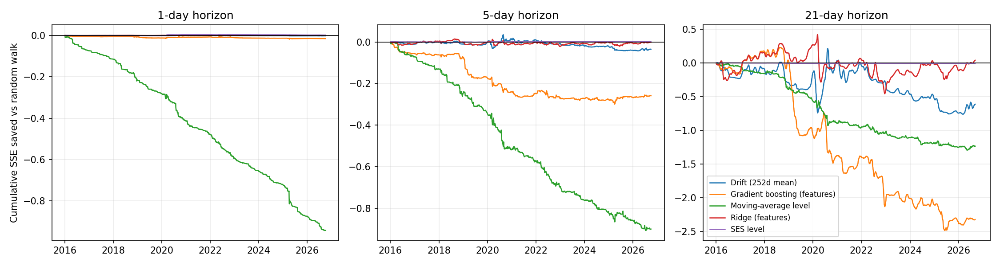
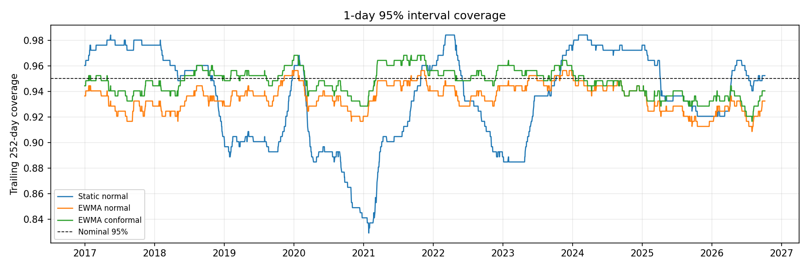
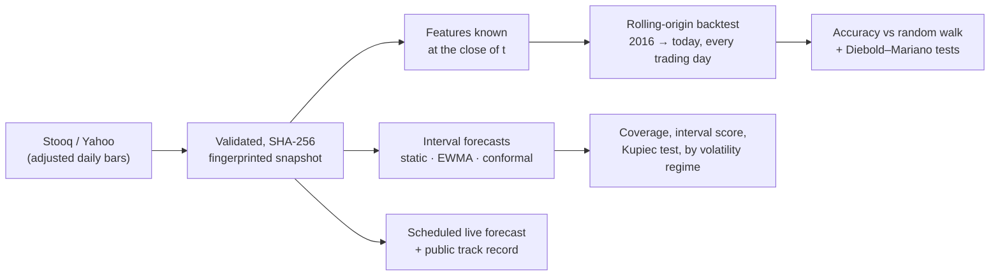

# AAPL Forecasting: Rolling-Origin Backtest and Live Interval Forecasts

[](https://github.com/dbechrakis/aapl-forecasting-backtest/actions/workflows/evidence.yml)

**Result:** Across 2,705 daily origins, no model significantly beats the random walk on returns. GARCH-conformal intervals have the best interval score at 80%, and plain GARCH at 95%.

A forecasting study that answers two separate questions honestly. The results are below.

1. **Can any model beat the random walk at forecasting AAPL's 1-, 5- and 21-day returns?** If it does, is the gain statistically significant?
2. **Can the *size* of the next move be forecast**, so the intervals hold their stated coverage in both calm and volatile markets?

The two questions are kept apart because they usually have different answers. Direction is close to unpredictable for a liquid large-cap stock. Volatility clusters, so uncertainty can be forecast.

**Stack:** Python · pandas · NumPy · SciPy · scikit-learn · arch (GARCH) · Matplotlib · GitHub Actions

## Results (AAPL, 2,705 daily origins, Jan 2016 to Oct 2026)

Snapshot: Yahoo split- and dividend-adjusted daily bars, 2010-01-04 to 2026-10-07. It has 4,216 rows and SHA-256 `c9c5e42c…` (see [`data/manifest.json`](data/manifest.json)). It was produced by the [`Refresh backtest`](.github/workflows/refresh-backtest.yml) workflow on 2026-10-08.

### 1. Nothing beats the random walk, and the most flexible model is significantly worse

| Model | MAE vs RW, 1d | 5d | 21d | Significantly different from RW? (DM, squared error) |
|---|---:|---:|---:|---|
| Ridge (13 features) | 0.998 | 0.993 | **0.965** | No at any horizon (p ≥ 0.45) |
| Drift (252-day mean) | 1.001 | 0.992 | 0.999 | No (p ≥ 0.49) |
| SES level | 1.000 | 1.001 | 1.001 | No (p ≥ 0.31) |
| Gradient boosting (13 features) | 1.013 | 1.032 | 1.039 | **Worse** at 5d (p = 0.001) and 21d (p = 0.021) |
| Moving-average level | 1.547 | 1.137 | 1.040 | **Worse** at every horizon (p < 0.001) |



- **Ridge's 3.5% lower 21-day MAE is not evidence of skill.** The Diebold-Mariano test cannot separate it from the random walk (p = 0.11 on absolute error, p = 0.96 on squared error). The cumulative plot shows the advantage repeatedly appearing and vanishing.
- **Gradient boosting fits noise.** Its losses pile up after the 2019 to 2020 regime changes. That is the expected failure mode of a flexible learner on a near-unpredictable target.
- **Direction:** no model's hit rate beats the trivial "always up" rate for the same period (53.6% at 1d, 58.5% at 5d, 64.4% at 21d). The best is Ridge at 61.3% for 21 days.
- The tuning of the coursework smoothers itself points to the random walk. On the pre-2016 burn-in, SES chose α = 0.95 and the moving average chose its shortest window (5 days).

### 2. The size of the next move *is* forecastable

| 1-day interval | Coverage at 80% | at 95% | 95% in high volatility | 95% in low volatility | Kupiec p (95%) |
|---|---:|---:|---:|---:|---:|
| Static normal | 83.7% | 93.6% | 90.7% | 97.0% | 0.002 |
| EWMA normal | 82.8% | 93.6% | 94.5% | 92.5% | 0.001 |
| EWMA conformal | 80.3% | 94.7% | 96.2% | 93.0% | 0.50 |
| GARCH normal | 83.7% | 94.6% | 94.5% | 94.7% | 0.35 |
| **GARCH conformal** | **80.3%** | **94.6%** | **94.7%** | **94.6%** | **0.35** |



- **Only the conformal intervals pass the coverage test at both levels.** Kupiec p = 0.74 at 80% for both conformal methods. The static and EWMA-normal intervals are rejected at both levels. GARCH-normal passes at 95% but over-covers at 80%.
- **A constant-width interval fails when it matters.** It covers 90.7% instead of 95% in volatile periods, and its trailing-year coverage fell to 83% in early 2021. It over-covers in calm periods.
- **Mean-reverting volatility fixes the long horizons.** Scaling today's EWMA volatility by √h assumes volatility stays put for the whole month. EWMA-conformal intervals were right on average at 21 days, but they covered 87.4% in volatile periods and 69.4% in calm ones (80% target), and the plain static interval beat them on interval score. A GARCH(1,1), refitted every 21 days on data up to the origin, forecasts each day's variance decaying back towards its long-run level:

| 21-day, 80% target | Coverage | High volatility | Low volatility | Interval score (lower is better) |
|---|---:|---:|---:|---:|
| Static normal | 76.5% | 72.1% | 81.6% | 0.281 |
| EWMA conformal | 79.1% | 87.4% | 69.4% | 0.297 |
| **GARCH conformal** | **78.9%** | **79.5%** | **78.2%** | **0.278** |

GARCH-conformal has the best interval score at 80% for every horizon. Plain GARCH has the best at 95%, by 0.7% to 1.9% of the score. The live forecast uses GARCH-conformal at both levels, so its 95% intervals are a little behind the best method in the backtest.

Full tables: [`accuracy.csv`](outputs/backtest/accuracy.csv) · [`interval_calibration.csv`](outputs/backtest/interval_calibration.csv) · [all forecasts](outputs/backtest/predictions.csv.gz) · [run manifest](outputs/backtest/run_manifest.json).

## Does it hold beyond AAPL?

The same backtest, intervals and tests were run on 20 large US stocks chosen before the run by one rule that does not look at returns: the largest S&P 500 members by market capitalisation at the end of 2015, with the list fixed in [`VALIDATION.md`](VALIDATION.md). All 20 downloaded and validated, and none was dropped. [`scripts/run_panel.py`](scripts/run_panel.py) runs it and the numbers below are generated from [`outputs/panel/`](outputs/panel/) and checked by a test. Prices are not committed. The manifest records each snapshot's fingerprint.

<!-- panel:start -->
**Point forecasts, ratio of RMSE to the random walk, Diebold-Mariano on squared error, 20 tickers.**

| Horizon | Model | Median RMSE vs random walk | Better, p < 0.05 | Worse, p < 0.05 | Better after BH | Worse after BH |
|---:|---|---:|---:|---:|---:|---:|
| 1d | Drift | 1.001 | 0 | 2 | 0 | 0 |
| 1d | Gradient boosting | 1.011 | 0 | 10 | 0 | 3 |
| 1d | Moving-average level | 1.435 | 0 | 20 | 0 | 20 |
| 1d | Ridge | 1.001 | 0 | 0 | 0 | 0 |
| 1d | SES level | 0.999 | 1 | 0 | 0 | 0 |
| 5d | Drift | 1.007 | 0 | 4 | 0 | 0 |
| 5d | Gradient boosting | 1.036 | 0 | 15 | 0 | 14 |
| 5d | Moving-average level | 1.104 | 0 | 20 | 0 | 20 |
| 5d | Ridge | 1.013 | 0 | 6 | 0 | 4 |
| 5d | SES level | 1.000 | 1 | 1 | 0 | 0 |
| 21d | Drift | 1.029 | 0 | 3 | 0 | 0 |
| 21d | Gradient boosting | 1.045 | 0 | 7 | 0 | 2 |
| 21d | Moving-average level | 1.024 | 0 | 19 | 0 | 19 |
| 21d | Ridge | 1.033 | 0 | 4 | 0 | 0 |
| 21d | SES level | 1.000 | 0 | 0 | 0 | 0 |

**Intervals, 20 tickers.**

| Level | Method | Tickers passing Kupiec at 1 day | Mean coverage at 1 day | Median interval score vs static at 1, 5 and 21 days |
|---|---|---:|---:|---|
| 80% | Static normal | 3 of 20 | 0.829 | 1.000, 1.000, 1.000 |
| 80% | EWMA normal | 1 of 20 | 0.826 | 0.955, 0.990, 1.026 |
| 80% | EWMA conformal | 20 of 20 | 0.800 | 0.951, 0.990, 1.046 |
| 80% | GARCH normal | 1 of 20 | 0.832 | 0.951, 0.977, 0.986 |
| 80% | GARCH conformal | 20 of 20 | 0.797 | 0.949, 0.976, 0.992 |
| 95% | Static normal | 4 of 20 | 0.934 | 1.000, 1.000, 1.000 |
| 95% | EWMA normal | 4 of 20 | 0.938 | 0.898, 0.946, 1.030 |
| 95% | EWMA conformal | 20 of 20 | 0.948 | 0.898, 0.956, 1.090 |
| 95% | GARCH normal | 10 of 20 | 0.942 | 0.878, 0.927, 0.956 |
| 95% | GARCH conformal | 19 of 20 | 0.946 | 0.881, 0.936, 1.004 |
<!-- panel:end -->

- **No model beats the random walk, on any ticker, once the p-values are corrected.** "Better after BH" is 0 in every row. Before correction at most one ticker of 20 is better for any model, which is what 5% of 20 gives by chance. The finding on AAPL holds on the panel.
- **Gradient boosting is worse, as on AAPL.** At 5 days it is significantly worse on 15 tickers and 14 survive the correction. At 21 days it is 7 and 2, and at 1 day 10 and 3. The moving-average level is worse on 19 or 20 of 20 at every horizon.
- **The 21-day gain of Ridge on AAPL does not repeat.** Its median RMSE ratio on the panel is above 1 at every horizon (1.001, 1.013, 1.033).
- **Only the conformal 1-day intervals hold their coverage, on every ticker.** EWMA conformal passes Kupiec's test on 20 of 20 tickers at 80% and 95%. GARCH conformal passes on 20 of 20 at 80% and 19 of 20 at 95%. GARCH normal passes on 1 and 10, EWMA normal on 1 and 4, and the static interval on 3 and 4.
- **The interval-score ranking is only partly the same as on AAPL.** GARCH conformal has the lowest median score at 80% for 1 and 5 days, but plain GARCH is lowest at 21 days, and plain GARCH is lowest at 95% for every horizon. EWMA conformal is worse than the static interval at 21 days (1.046 at 80%, 1.090 at 95%), as on AAPL.
- **Limits.** Twenty large stocks share market moves, so their tests are not independent. They are survivors. The ranking that defined the list was recalled from memory and not looked up. The panel's AAPL row differs from the table above only by the newer snapshot.

## Design



### Point forecasts of h-day log returns (h = 1, 5, 21)

| Model | What it forecasts | Fitted on |
|---|---|---|
| Random walk | zero return (benchmark) | n/a |
| Drift | trailing 252-day mean return × h | expanding history |
| SES level / moving-average level | mean reversion towards a smoothed price, from the original coursework | α and window tuned once, on the pre-2016 burn-in |
| Ridge | 13 features: momentum, realised and EWMA volatility, 52-week-high distance, range, volume z-score, weekday | refitted every 21 trading days |
| Gradient boosting | the same 13 features, shallow trees | refitted every 21 trading days |

### Leakage rules (each one is tested)

- Every feature at origin *t* uses prices and volume up to the close of *t* only.
- At a refit on day *t*, a training row *j* is used only if its label had matured, meaning *j + h ≤ t*. Overlapping multi-day labels therefore never reach past the origin.
- Smoother hyperparameters are tuned once, on targets that matured before the first origin.
- Conformal intervals at *t* use only standardized outcomes that had matured by *t*.
- **Test:** perturbing every price after day *t* must leave features, point forecasts, tuning and interval bounds at or before *t* bit-identical. Deliberately reintroducing either leak makes the test fail. This was checked by mutation.

### Evaluation

- **Accuracy:** MAE and RMSE as ratios to the random walk (below 1 beats it).
- **Significance:** Diebold-Mariano with the Harvey-Leybourne-Newbold small-sample correction. A long-run variance up to lag *h − 1* accounts for overlapping multi-day errors.
- **Direction:** hit rate, compared with the trivial "always up" rate over the same period. A directional claim must beat that rate, not 50%.
- **Intervals at 80% and 95%:**
  - Five methods are compared, all centred on the random walk:
    - static normal
    - EWMA normal (RiskMetrics λ = 0.94)
    - GARCH(1,1) normal, refitted every 21 days with the h-day variance reverting to its long-run level
    - two split-conformal versions, which scale empirical quantiles of the last 1,000 matured standardized outcomes by EWMA or by GARCH volatility.
  - Each is scored on coverage overall and in the high- and low-volatility halves, on mean width and on the Winkler interval score.
  - Kupiec's proportion-of-failures test is reported at h = 1, the only horizon where outcomes are independent.

## Live forecasting in production

[`live-forecast.yml`](.github/workflows/live-forecast.yml) runs after every US close:

1. Downloads a fresh snapshot.
2. Issues 1-, 5- and 21-day GARCH-conformal intervals at 80% and 95%.
3. Scores every earlier forecast whose horizon has passed.
4. Commits the result to [`outputs/live/forecast_log.csv`](outputs/live/) and [`track_record.csv`](outputs/live/).

<!-- live-track-record:start -->
Live GARCH-conformal forecasts issued since 2026-10-08: 25 origins, 98 intervals scored so far (latest outcome 2026-11-12). Updated automatically after each US close.

| Horizon | Level | Scored | Live coverage (95% interval) | Backtest coverage |
|---:|---:|---:|---|---:|
| 1d | 80% | 24 | 79.2% (60% to 91%) | 80.3% |
| 1d | 95% | 24 | 95.8% (80% to 99%) | 94.6% |
| 5d | 80% | 20 | 90.0% (70% to 97%) | 79.5% |
| 5d | 95% | 20 | 100.0% (84% to 100%) | 94.7% |
| 21d | 80% | 5 | 100.0% (57% to 100%) | 78.9% |
| 21d | 95% | 5 | 100.0% (57% to 100%) | 94.7% |

Overlapping multi-day intervals are not independent, so the 5- and 21-day intervals are optimistic. A live coverage far outside its interval is a reason to look, not proof of a miscalibrated method.
<!-- live-track-record:end -->

The bounds are stored in log-return space and scored with close-to-close ratios. A later dividend re-adjustment of the price history therefore cannot change a past score. A test covers this. The log is append-only and timestamped. Over time it becomes an out-of-sample record that no backtest can be tuned to.

## Synthetic sanity check

The test suite also runs the pipeline on simulated GARCH(1,1) prices, where the right answer is known: direction is unpredictable and volatility clusters. As expected, no model beats the random walk there and the conformal interval is calibrated. This checks the method. It says nothing about AAPL.

## Run locally

```bash
python -m venv .venv && source .venv/bin/activate
python -m pip install -r requirements.txt
make check        # lint + evidence + 28 tests (~10 s)
make data         # download and fingerprint the snapshot (Yahoo, with Stooq as fallback)
make backtest     # ~2 min; writes outputs/backtest/
make forecast     # issue and score live forecasts
```

## Repository structure

```text
src/aapl_forecast/
├── data.py          # Download (Stooq → Yahoo fallback), validation, fingerprinting
├── features.py      # Features known at the close; h-day targets
├── backtest.py      # Rolling-origin backtest with matured-label refits
├── evaluation.py    # Accuracy vs random walk, Diebold–Mariano
├── garch.py         # GARCH(1,1) h-day volatility with mean reversion
└── intervals.py     # Static / EWMA / GARCH, normal and conformal intervals, coverage, Kupiec
scripts/             # download_data, run_backtest, forecast_latest
tests/               # look-ahead, statistics, validation and live-scoring tests
coursework/          # Original January-window coursework experiment (archived)
.github/workflows/   # CI, manual backtest refresh, scheduled live forecast
```

## Original coursework (archived)

The project began as an MSc coursework experiment. It trained on January only and forecast February to December price levels for 2023 and 2024, using naive, moving-average, SES and trend-seasonal methods. That code now sits in [`coursework/`](coursework/), with its corrected tuning rules still under test.

Its historical score table stays withdrawn: the original source CSV was never committed, so it cannot be reproduced. The rolling-origin study replaces that design, which had one training window per year and a single long horizon. The [report](coursework/Final_Report.docx) and [presentation](coursework/ITC6002_Final_Project_Presentation.pptx) are archived coursework artifacts. The original report credits Nikitas Valtadoros, David Frederick and Dimitris Bechrakis.

## Limitations

- Prices come from a free provider's adjusted series (Yahoo, since Stooq now serves a browser challenge to scripts). Adjustment conventions differ between providers, so the snapshot fingerprint matters more than the source name.
- One asset only. A positive finding on AAPL would still need testing on other tickers before it could be called general.
- No transaction costs or trading rules. This is forecast evaluation, not a strategy backtest.
- Learned models are refitted every 21 trading days, not daily, to keep compute small.

## Author

**Dimitris Bechrakis**, MSc Data Science, The American College of Greece.

## Licensing

See [licensing scope](LICENSING.md) for the MIT-licensed code and the separately governed coursework materials.
